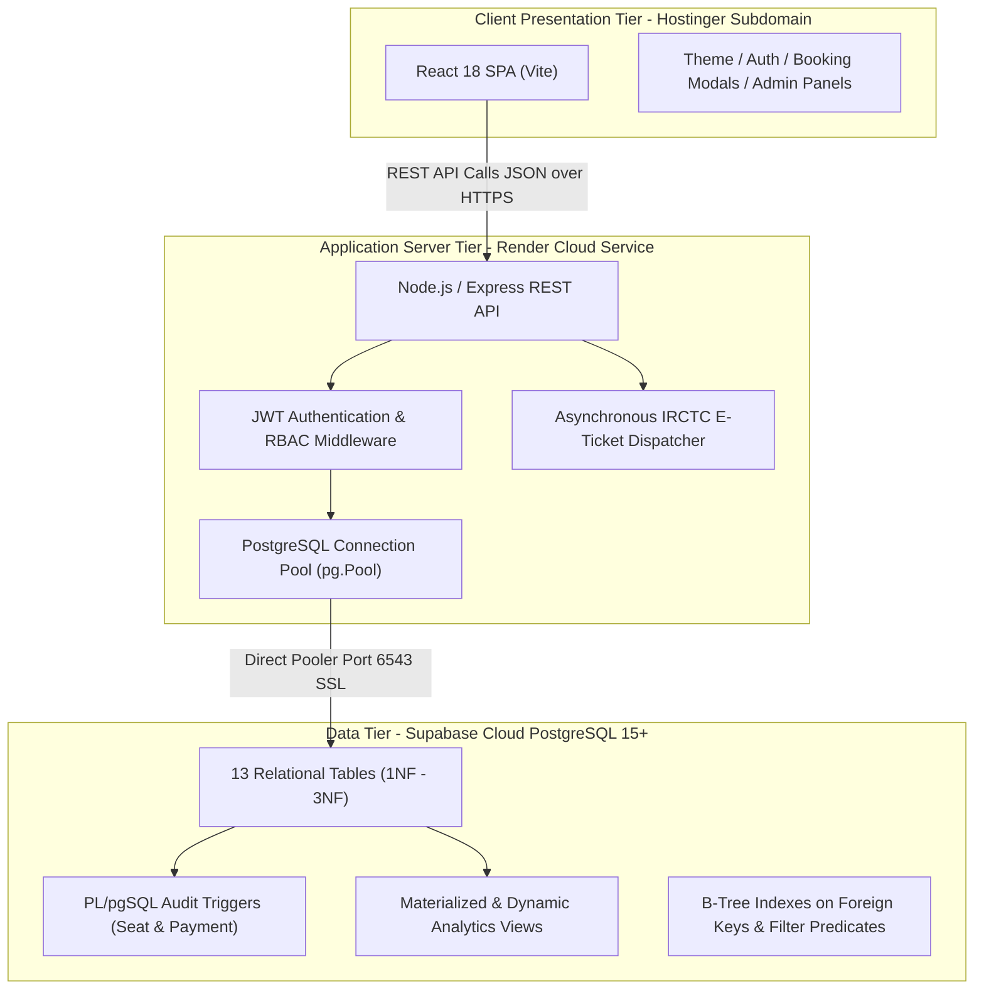
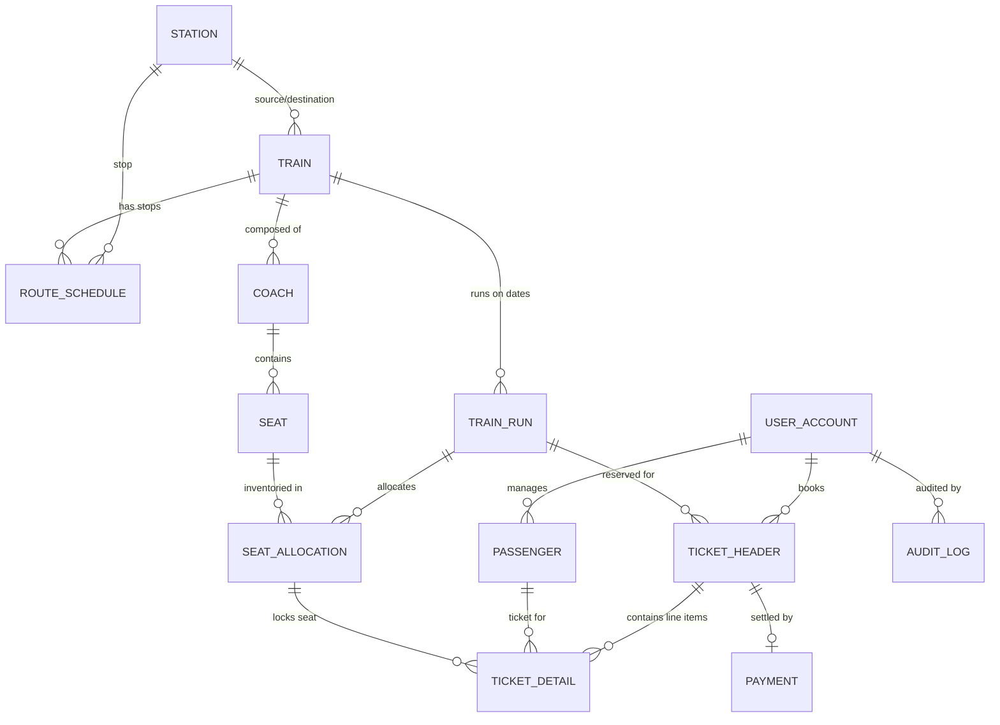
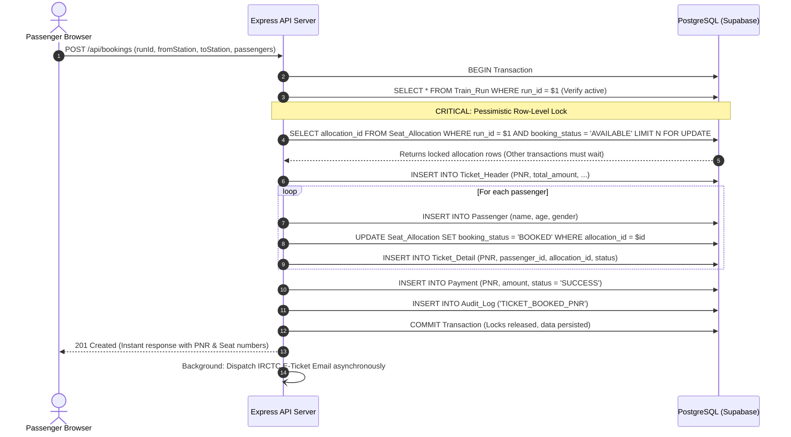

# 🚆 Indian Railways Management System (IRCTC-Grade DBMS Project)
## Comprehensive Technical Architecture, Data Flows, and Complete SQL Query Handbook
*Prepared for Academic Project Review & Technical Evaluation*

---

## 📑 Table of Contents
1. [Executive Summary & High-Level Architecture](#1-executive-summary--high-level-architecture)
2. [Complete Technology Stack Breakdown](#2-complete-technology-stack-breakdown)
3. [Database Schema & Relational Design (13 Tables)](#3-database-schema--relational-design-13-tables)
4. [Relational Integrity & Normalization Proofs (1NF to BCNF)](#4-relational-integrity--normalization-proofs-1nf-to-bcnf)
5. [Feature-by-Feature Data Flows & Logic](#5-feature-by-feature-data-flows--logic)
   - 5.1 User Authentication & RBAC (JWT & bcrypt)
   - 5.2 Dynamic Train Search & Directional Route Sequence Matching
   - 5.3 ACID-Compliant Booking Engine with Pessimistic Row Locking (`FOR UPDATE`)
   - 5.4 Payment Settlement & ACID Rollback Simulation
   - 5.5 PNR Status Lookup & Ticket History
   - 5.6 Ticket Cancellation & Inventory Reclaim Transaction
   - 5.7 Automated E-Ticket Generation & Asynchronous Email Service
   - 5.8 Admin Subsystems (Fleet, Station Stops, Daily Runs, Coaches & Audit Logs)
6. [Complete SQL Query Handbook (Every Query in the Project)](#6-complete-sql-query-handbook)
   - 6.1 DDL Schema Definitions & Constraints
   - 6.2 PL/pgSQL Stored Procedures & Triggers
   - 6.3 Relational Views (`CREATE VIEW`)
   - 6.4 Core Application Queries (Search, Booking Transaction, Cancellation)
   - 6.5 Relational Algebra & Advanced DBMS Queries (JOINs, Subqueries, Aggregations, Set Operations)
7. [DBMS Theory & Concurrency Defense (ACID, MVCC, Indexing)](#7-dbms-theory--concurrency-defense)
8. [Examiner Viva Q&A / Review Cheat Sheet](#8-examiner-viva-qa--review-cheat-sheet)

---

## 1. Executive Summary & High-Level Architecture

The **Railway Management System (RMS)** is a full-stack, enterprise-grade relational database application designed to replicate the core reservation, scheduling, and inventory management capabilities of Indian Railways (IRCTC). 

The system solves critical relational database challenges:
1. **Pessimistic Concurrency Control**: Preventing overbooking and race conditions when multiple passengers attempt to book the last seat simultaneously.
2. **ACID Transaction Guarantees**: Ensuring that ticket creation, passenger registration, seat status mutation, and payment recording occur as an all-or-nothing unit of work.
3. **Complex Directional Graph Traversal**: Querying route schedules to verify station order (`Origin_Sequence < Destination_Sequence`) before presenting bookable train runs.
4. **Audit Immutability**: Tracking all critical financial transactions and inventory mutations via automated PostgreSQL database triggers.



---

## 2. Complete Technology Stack Breakdown

| Layer | Technology | Version | Architectural Role & Purpose |
|---|---|---|---|
| **Database (RDBMS)** | **PostgreSQL (Supabase)** | **15+ / 17.11** | Cloud-native relational database engine executing ACID transactions, row-level locks, PL/pgSQL triggers, and foreign key cascades. |
| **Backend Runtime** | **Node.js** | **v20 LTS** | Asynchronous, event-driven runtime handling concurrent HTTP requests and non-blocking I/O. |
| **Backend Framework** | **Express.js** | **4.18+** | RESTful routing, centralized error handling, and JSON serialization. |
| **Database Driver** | **`pg` (node-postgres)** | **8.11+** | Connection pooling (`pg.Pool`), parameterized query execution to block SQL injection, and manual client transaction management (`BEGIN / COMMIT / ROLLBACK`). |
| **Authentication** | **jsonwebtoken & bcryptjs** | **9.0 / 2.4** | Stateless authorization via signed HS256 JWT tokens; salted password hashing (10 salt rounds). |
| **Email Service** | **Nodemailer** | **6.9+** | HTML E-ticket template rendering and SMTP transport with strict 4s timeout fallback. |
| **Frontend Framework** | **React.js** | **18.3+** | Component-driven declarative UI utilizing Context API for auth and dark/light theming. |
| **Build Tool** | **Vite** | **5.4+** | Fast Rollup-based bundling producing optimized static distribution assets. |
| **Styling** | **Vanilla Modern CSS** | **CSS3** | Glassmorphism, tailored HSL color tokens, responsive CSS Grid / Flexbox layouts, dynamic dark/light themes. |
| **Cloud Deployment** | **Hostinger + Render** | **Production** | Frontend static assets hosted on Hostinger Subdomain; Backend hosted as a containerized web service on Render connected to GitHub CI/CD. |

---

## 3. Database Schema & Relational Design (13 Tables)

The database schema is organized into three decoupled structural tiers:



### Table Dictionary & Primary/Foreign Key Definitions

| # | Table Name | Architectural Purpose | Primary Key | Foreign Keys & Constraints | Unique Constraints |
|---|---|---|---|---|---|
| **1** | `Station` | Master railway stations | `Station_ID` | None | `Station_Code` |
| **2** | `Train` | Master train entities | `Train_ID` | `Source_ID` &rarr; `Station(Station_ID)`, `Destination_ID` &rarr; `Station(Station_ID)` | None |
| **3** | `Route_Schedule` | Ordered intermediate stops & timings | `Schedule_ID` | `Train_ID` &rarr; `Train`, `Station_ID` &rarr; `Station` | `(Train_ID, Stop_Sequence)`, `(Train_ID, Station_ID)` |
| **4** | `Coach` | Train coaches / rolling stock | `Coach_ID` | `Train_ID` &rarr; `Train` (ON DELETE CASCADE) | None |
| **5** | `Seat` | Physical seats inside coaches | `Seat_ID` | `Coach_ID` &rarr; `Coach` (ON DELETE CASCADE) | `(Coach_ID, Seat_Number)` |
| **6** | `Train_Run` | Daily scheduled instance on a date | `Run_ID` | `Train_ID` &rarr; `Train` (ON DELETE CASCADE) | `(Train_ID, Service_Date)` |
| **7** | `Seat_Allocation` | Per-run seat inventory availability | `Allocation_ID` | `Run_ID` &rarr; `Train_Run`, `Seat_ID` &rarr; `Seat` | `(Run_ID, Seat_ID)` |
| **8** | `User_Account` | Authentication & system roles | `User_ID` | None | `Email` |
| **9** | `Passenger` | Traveler profile under an account | `Passenger_ID` | `User_ID` &rarr; `User_Account` (ON DELETE CASCADE) | None |
| **10** | `Ticket_Header` | Master reservation transaction (PNR) | `PNR` (VARCHAR(10)) | `User_ID` &rarr; `User_Account`, `Run_ID` &rarr; `Train_Run`, `From_Station_ID` &rarr; `Station`, `To_Station_ID` &rarr; `Station` | None |
| **11** | `Ticket_Detail` | Per-passenger reservation line item | `Detail_ID` | `PNR` &rarr; `Ticket_Header`, `Passenger_ID` &rarr; `Passenger`, `Allocation_ID` &rarr; `Seat_Allocation` | None |
| **12** | `Payment` | Settlement attempt and status | `Transaction_ID` | `PNR` &rarr; `Ticket_Header` (ON DELETE CASCADE) | None |
| **13** | `Audit_Log` | Immutable event log & audit trail | `Log_ID` | `User_ID` &rarr; `User_Account` (ON DELETE SET NULL) | None |

---

## 4. Relational Integrity & Normalization Proofs (1NF to BCNF)

### First Normal Form (1NF)
* **Definition**: All attributes must be atomic; no multi-valued attributes or repeating groups.
* **Proof**: In the reservation module, instead of storing a comma-separated list of passenger names inside `Ticket_Header`, passenger entries are normalized into atomic records in the `Passenger` table and mapped via single-record line items in `Ticket_Detail`.

### Second Normal Form (2NF)
* **Definition**: Must be in 1NF, and every non-prime attribute must be fully functionally dependent on the entire primary key (no partial dependencies on candidate keys).
* **Proof**: In composite candidate key tables such as `Route_Schedule(Train_ID, Stop_Sequence)`, the timing attributes (`Arrival_Time`, `Departure_Time`) depend on both the train and its sequence position in the itinerary, not on `Train_ID` alone. Tables with surrogate identity keys are in 2NF by definition.

### Third Normal Form (3NF)
* **Definition**: Must be in 2NF, and no non-prime attribute is transitively dependent on the primary key ($X \to Y$ and $Y \to Z$).
* **Proof**: 
  1. `Coach` does not duplicate capacity; coach capacity is computed dynamically via `COUNT(Seat_ID)`.
  2. `Ticket_Header` references `From_Station_ID` and `To_Station_ID`. It deliberately does not store station names, city, or state, avoiding the transitive dependency `PNR -> Station_ID -> Station_Name`.
  3. Physical maintenance condition (`Seat.Physical_Condition`) is decoupled from daily runtime inventory availability (`Seat_Allocation.Booking_Status`).

### Boyce-Codd Normal Form (BCNF)
* **Definition**: For every non-trivial functional dependency $X \to Y$, $X$ must be a superkey.
* **Proof**: In `Route_Schedule`, both candidate keys (`Schedule_ID` and `(Train_ID, Stop_Sequence)`) act as strict determinants for all other attributes. The schema satisfies BCNF across primary transaction workflows.

---

## 5. Feature-by-Feature Data Flows & Logic

### 5.1 User Authentication & RBAC
1. **User Request**: Passenger or Admin submits email and password.
2. **Password Verification**: Backend hashes password via `bcrypt.compare(plaintext, hash)`.
3. **Token Generation**: Signs a JWT payload `{ userId, email, role }` with a 7-day expiration.
4. **Authorization Middleware**: Protected routes check the `Authorization: Bearer <token>` header and enforce role checks (e.g. `requireAdmin`).

```
[Client] ---> POST /api/auth/login ---> [Auth Controller]
                                              |
                     SELECT * FROM User_Account WHERE Email = $1
                                              |
                                      bcrypt.compare()
                                              |
                                     jwt.sign({ userId, role })
                                              |
[Client] <--- Return JWT & User Object <-------+
```

---

### 5.2 Dynamic Train Search & Directional Route Sequence Matching
To search for trains between Station A and Station B on Date D:
1. Performs a **self-join** on `Route_Schedule` (`rs1` for origin, `rs2` for destination).
2. Verifies route directionality: `rs1.Stop_Sequence < rs2.Stop_Sequence`.
3. Matches or auto-provisions active `Train_Run` for Date D.
4. Aggregates available seats from `Seat_Allocation` where `Booking_Status = 'AVAILABLE'`.
5. Calculates the fare based on stop difference: $\text{Fare} = \text{BaseFare} + (\Delta \text{Stops} \times \text{Multiplier})$.

```
[Search Form: Origin, Destination, Date]
                   |
     GET /api/trains/search?from=1&to=4&date=2026-10-31
                   |
[Express Server queries PostgreSQL]
   JOIN Route_Schedule rs1 (Station 1)
   JOIN Route_Schedule rs2 (Station 4)
   WHERE rs1.Stop_Sequence < rs2.Stop_Sequence
   JOIN Train_Run (Date = 2026-10-31)
   COUNT(Seat_Allocation.Booking_Status = 'AVAILABLE')
                   |
[JSON Results returned with train list, departure time, seats available, fare]
```

---

### 5.3 ACID-Compliant Booking Engine (Pessimistic Row Locking)
When a passenger clicks **"Confirm & Pay"**:



---

### 5.4 Payment Settlement & ACID Rollback Simulation
The system features an explicit **"Simulate Payment Failure"** toggle to demonstrate the **Atomicity (A)** property of ACID:
1. When simulated failure is triggered, the server executes `INSERT INTO Payment (status = 'FAILED')`.
2. It immediately issues `ROLLBACK;`.
3. **Database Result**: Any locked seats revert to `AVAILABLE`. No records in `Ticket_Header` or `Ticket_Detail` persist. The database state remains completely uncontaminated.

---

### 5.5 PNR Status Lookup & Ticket History
1. Client requests `GET /api/bookings/pnr/:pnr`.
2. Executes a join across `Ticket_Header`, `Train_Run`, `Train`, `Station`, `Ticket_Detail`, `Passenger`, `Seat_Allocation`, `Seat`, and `Coach`.
3. Returns complete itinerary, coach and berth allocations, passenger status (`CONFIRMED` or `WAITLIST`), and payment status.

---

### 5.6 Ticket Cancellation & Inventory Reclaim Transaction
When a passenger cancels their booking:
1. `BEGIN;`
2. `UPDATE Ticket_Detail SET Current_Status = 'CANCELLED' WHERE PNR = $1;`
3. `UPDATE Seat_Allocation SET Booking_Status = 'AVAILABLE' WHERE Allocation_ID IN (SELECT Allocation_ID FROM Ticket_Detail WHERE PNR = $1);`
4. `INSERT INTO Payment (PNR, Amount, Payment_Status) VALUES ($1, refundAmount, 'REFUNDED');`
5. `INSERT INTO Audit_Log ('TICKET_CANCELLED_PNR');`
6. `COMMIT;` (Seat inventory is immediately restored to the available pool for other passengers).

---

### 5.7 Automated E-Ticket Generation & Asynchronous Email Service
1. After the database commits, the backend compiles an official IRCTC-styled HTML ticket slip with passenger names, berth numbers, QR representation, and booking metadata.
2. The email service runs **asynchronously in the background** without delaying the HTTP response.
3. If external SMTP is not configured, it records the slip in `sentEmailsLog`, making it instantly viewable and printable via the **"View E-Ticket Slip"** button in the modal.

---

### 5.8 Admin Subsystems
* **Fleet Management**: Register physical trains, assign source and destination stations.
* **Route Timetable Editor**: Set ordered station stops with arrival and departure times (`HH:MM`).
* **Train Run Scheduler**: Create operational instances on calendar dates and initialize seat inventory.
* **Rolling Stock & Coach Manager**: Configure coach types (1A, 2A, 3A, SL, CC, EC) and individual seat maintenance condition (`OPERATIONAL` vs `UNDER_REPAIR`).
* **Live Audit Log & Analytics**: Inspect live triggers, system mutations, and occupancy percentages via database views.

---

## 6. Complete SQL Query Handbook

### 6.1 DDL Schema Definitions & Constraints

```sql
-- 1. Station Master
CREATE TABLE Station (
    Station_ID INT GENERATED BY DEFAULT AS IDENTITY PRIMARY KEY,
    Station_Code VARCHAR(10) UNIQUE NOT NULL,
    Name VARCHAR(100) NOT NULL,
    City VARCHAR(50) NOT NULL,
    State VARCHAR(50) NOT NULL
);
CREATE INDEX idx_station_code ON Station (Station_Code);
CREATE INDEX idx_station_city ON Station (City);

-- 2. Train Master
CREATE TABLE Train (
    Train_ID INT GENERATED BY DEFAULT AS IDENTITY PRIMARY KEY,
    Name VARCHAR(100) NOT NULL,
    Type VARCHAR(30) NOT NULL,
    Source_ID INT NOT NULL REFERENCES Station(Station_ID) ON DELETE RESTRICT,
    Destination_ID INT NOT NULL REFERENCES Station(Station_ID) ON DELETE RESTRICT
);
CREATE INDEX idx_train_type ON Train (Type);

-- 3. Route Schedule (Ordered Stops & Timetables)
CREATE TABLE Route_Schedule (
    Schedule_ID INT GENERATED BY DEFAULT AS IDENTITY PRIMARY KEY,
    Train_ID INT NOT NULL REFERENCES Train(Train_ID) ON DELETE CASCADE,
    Station_ID INT NOT NULL REFERENCES Station(Station_ID) ON DELETE RESTRICT,
    Stop_Sequence INT NOT NULL,
    Arrival_Time TIME NULL,
    Departure_Time TIME NULL,
    CONSTRAINT uq_train_sequence UNIQUE (Train_ID, Stop_Sequence),
    CONSTRAINT uq_train_station UNIQUE (Train_ID, Station_ID)
);
CREATE INDEX idx_schedule_train_seq ON Route_Schedule (Train_ID, Stop_Sequence);

-- 4. Coach (Rolling Stock)
CREATE TABLE Coach (
    Coach_ID INT GENERATED BY DEFAULT AS IDENTITY PRIMARY KEY,
    Train_ID INT NOT NULL REFERENCES Train(Train_ID) ON DELETE CASCADE,
    Coach_Type VARCHAR(20) NOT NULL
);
CREATE INDEX idx_coach_train ON Coach (Train_ID);

-- 5. Seat Hardware
CREATE TABLE Seat (
    Seat_ID INT GENERATED BY DEFAULT AS IDENTITY PRIMARY KEY,
    Coach_ID INT NOT NULL REFERENCES Coach(Coach_ID) ON DELETE CASCADE,
    Seat_Number VARCHAR(10) NOT NULL,
    Physical_Condition VARCHAR(30) DEFAULT 'OPERATIONAL' CHECK (Physical_Condition IN ('OPERATIONAL', 'UNDER_REPAIR')),
    CONSTRAINT uq_coach_seat UNIQUE (Coach_ID, Seat_Number)
);
CREATE INDEX idx_seat_condition ON Seat (Physical_Condition);

-- 6. Train Run (Scheduled Daily Date Instance)
CREATE TABLE Train_Run (
    Run_ID INT GENERATED BY DEFAULT AS IDENTITY PRIMARY KEY,
    Train_ID INT NOT NULL REFERENCES Train(Train_ID) ON DELETE CASCADE,
    Service_Date DATE NOT NULL,
    Run_Status VARCHAR(20) DEFAULT 'SCHEDULED' CHECK (Run_Status IN ('SCHEDULED', 'RUNNING', 'DELAYED', 'CANCELLED', 'COMPLETED')),
    CONSTRAINT uq_train_date UNIQUE (Train_ID, Service_Date)
);
CREATE INDEX idx_run_date ON Train_Run (Service_Date);
CREATE INDEX idx_run_status ON Train_Run (Run_Status);

-- 7. Seat Allocation (Inventory per Run)
CREATE TABLE Seat_Allocation (
    Allocation_ID INT GENERATED BY DEFAULT AS IDENTITY PRIMARY KEY,
    Run_ID INT NOT NULL REFERENCES Train_Run(Run_ID) ON DELETE CASCADE,
    Seat_ID INT NOT NULL REFERENCES Seat(Seat_ID) ON DELETE CASCADE,
    Booking_Status VARCHAR(20) DEFAULT 'AVAILABLE' CHECK (Booking_Status IN ('AVAILABLE', 'BLOCKED', 'BOOKED')),
    CONSTRAINT uq_run_seat UNIQUE (Run_ID, Seat_ID)
);
CREATE INDEX idx_alloc_status ON Seat_Allocation (Run_ID, Booking_Status);

-- 8. User Account
CREATE TABLE User_Account (
    User_ID INT GENERATED BY DEFAULT AS IDENTITY PRIMARY KEY,
    Email VARCHAR(100) UNIQUE NOT NULL,
    Password_Hash VARCHAR(255) NOT NULL,
    Role VARCHAR(20) DEFAULT 'PASSENGER' CHECK (Role IN ('PASSENGER', 'ADMIN')),
    Created_At TIMESTAMPTZ DEFAULT CURRENT_TIMESTAMP
);
CREATE INDEX idx_user_email ON User_Account (Email);

-- 9. Passenger Traveler Profile
CREATE TABLE Passenger (
    Passenger_ID INT GENERATED BY DEFAULT AS IDENTITY PRIMARY KEY,
    User_ID INT NOT NULL REFERENCES User_Account(User_ID) ON DELETE CASCADE,
    Name VARCHAR(100) NOT NULL,
    Age INT NOT NULL CHECK (Age > 0 AND Age < 130),
    Gender VARCHAR(10) NOT NULL CHECK (Gender IN ('MALE', 'FEMALE', 'OTHER'))
);
CREATE INDEX idx_passenger_user ON Passenger (User_ID);

-- 10. Ticket Header (PNR Master Reservation)
CREATE TABLE Ticket_Header (
    PNR VARCHAR(10) PRIMARY KEY,
    User_ID INT NOT NULL REFERENCES User_Account(User_ID) ON DELETE RESTRICT,
    Run_ID INT NOT NULL REFERENCES Train_Run(Run_ID) ON DELETE RESTRICT,
    From_Station_ID INT NOT NULL REFERENCES Station(Station_ID) ON DELETE RESTRICT,
    To_Station_ID INT NOT NULL REFERENCES Station(Station_ID) ON DELETE RESTRICT,
    Total_Amount NUMERIC(10, 2) NOT NULL CHECK (Total_Amount >= 0),
    Booking_Date TIMESTAMPTZ DEFAULT CURRENT_TIMESTAMP
);
CREATE INDEX idx_ticket_user ON Ticket_Header (User_ID);
CREATE INDEX idx_ticket_run ON Ticket_Header (Run_ID);

-- 11. Ticket Detail (Passenger Seating Line Items)
CREATE TABLE Ticket_Detail (
    Detail_ID INT GENERATED BY DEFAULT AS IDENTITY PRIMARY KEY,
    PNR VARCHAR(10) NOT NULL REFERENCES Ticket_Header(PNR) ON DELETE CASCADE,
    Passenger_ID INT NOT NULL REFERENCES Passenger(Passenger_ID) ON DELETE RESTRICT,
    Allocation_ID INT NULL REFERENCES Seat_Allocation(Allocation_ID) ON DELETE SET NULL,
    Current_Status VARCHAR(20) DEFAULT 'CONFIRMED' CHECK (Current_Status IN ('CONFIRMED', 'WAITLIST', 'CANCELLED'))
);
CREATE INDEX idx_detail_pnr ON Ticket_Detail (PNR);
CREATE INDEX idx_detail_alloc ON Ticket_Detail (Allocation_ID);

-- 12. Payment Settlement
CREATE TABLE Payment (
    Transaction_ID INT GENERATED BY DEFAULT AS IDENTITY PRIMARY KEY,
    PNR VARCHAR(10) NOT NULL REFERENCES Ticket_Header(PNR) ON DELETE CASCADE,
    Amount NUMERIC(10, 2) NOT NULL CHECK (Amount >= 0),
    Payment_Status VARCHAR(20) NOT NULL CHECK (Payment_Status IN ('SUCCESS', 'FAILED', 'REFUNDED')),
    Timestamp TIMESTAMPTZ DEFAULT CURRENT_TIMESTAMP
);
CREATE INDEX idx_payment_pnr ON Payment (PNR);

-- 13. Audit Log
CREATE TABLE Audit_Log (
    Log_ID INT GENERATED BY DEFAULT AS IDENTITY PRIMARY KEY,
    Action_Type VARCHAR(50) NOT NULL,
    Table_Affected VARCHAR(50) NOT NULL,
    User_ID INT NULL REFERENCES User_Account(User_ID) ON DELETE SET NULL,
    Timestamp TIMESTAMPTZ DEFAULT CURRENT_TIMESTAMP
);
CREATE INDEX idx_audit_timestamp ON Audit_Log (Timestamp);
```

---

### 6.2 PL/pgSQL Stored Procedures & Triggers

```sql
-- Trigger Function: Audit Seat Status Changes (Available -> Booked -> Available)
CREATE OR REPLACE FUNCTION fn_seat_allocation_audit()
RETURNS TRIGGER AS $$
BEGIN
    IF (OLD.Booking_Status IS DISTINCT FROM NEW.Booking_Status) THEN
        INSERT INTO Audit_Log (Action_Type, Table_Affected, User_ID, Timestamp)
        VALUES (
            'SEAT_STATUS_' || OLD.Booking_Status || '_TO_' || NEW.Booking_Status,
            'Seat_Allocation',
            NULL,
            CURRENT_TIMESTAMP
        );
    END IF;
    RETURN NEW;
END;
$$ LANGUAGE plpgsql;

CREATE TRIGGER trg_seat_allocation_audit
AFTER UPDATE ON Seat_Allocation
FOR EACH ROW
EXECUTE FUNCTION fn_seat_allocation_audit();

-- Trigger Function: Audit Payment Processing
CREATE OR REPLACE FUNCTION fn_payment_audit()
RETURNS TRIGGER AS $$
BEGIN
    INSERT INTO Audit_Log (Action_Type, Table_Affected, User_ID, Timestamp)
    VALUES (
        'PAYMENT_' || NEW.Payment_Status || '_' || NEW.PNR,
        'Payment',
        NULL,
        CURRENT_TIMESTAMP
    );
    RETURN NEW;
END;
$$ LANGUAGE plpgsql;

CREATE TRIGGER trg_payment_audit
AFTER INSERT ON Payment
FOR EACH ROW
EXECUTE FUNCTION fn_payment_audit();
```

---

### 6.3 Relational Views (`CREATE VIEW`)

```sql
-- View 1: Complete Booking & Passenger Details
CREATE OR REPLACE VIEW vw_booking_details AS
SELECT 
    th.PNR AS "pnr",
    th.Booking_Date AS "booking_date",
    th.Total_Amount AS "total_amount",
    t.Name AS "train_name",
    t.Type AS "train_type",
    tr.Service_Date AS "service_date",
    s_from.Station_Code AS "from_station_code",
    s_from.Name AS "from_station_name",
    s_to.Station_Code AS "to_station_code",
    s_to.Name AS "to_station_name",
    u.Email AS "booker_email",
    p.Name AS "passenger_name",
    p.Age AS "passenger_age",
    p.Gender AS "passenger_gender",
    td.Current_Status AS "ticket_status",
    c.Coach_Type AS "coach_type",
    s.Seat_Number AS "seat_number",
    pay.Payment_Status AS "payment_status"
FROM Ticket_Header th
JOIN User_Account u ON th.User_ID = u.User_ID
JOIN Train_Run tr ON th.Run_ID = tr.Run_ID
JOIN Train t ON tr.Train_ID = t.Train_ID
JOIN Station s_from ON th.From_Station_ID = s_from.Station_ID
JOIN Station s_to ON th.To_Station_ID = s_to.Station_ID
JOIN Ticket_Detail td ON th.PNR = td.PNR
JOIN Passenger p ON td.Passenger_ID = p.Passenger_ID
LEFT JOIN Seat_Allocation sa ON td.Allocation_ID = sa.Allocation_ID
LEFT JOIN Seat s ON sa.Seat_ID = s.Seat_ID
LEFT JOIN Coach c ON s.Coach_ID = c.Coach_ID
LEFT JOIN Payment pay ON th.PNR = pay.PNR;

-- View 2: Real-time Train Occupancy Percentage
CREATE OR REPLACE VIEW vw_train_occupancy AS
SELECT 
    tr.Run_ID,
    t.Train_ID,
    t.Name AS "Train_Name",
    tr.Service_Date,
    tr.Run_Status,
    COUNT(sa.Allocation_ID) AS "Total_Allocated_Seats",
    SUM(CASE WHEN sa.Booking_Status = 'BOOKED' THEN 1 ELSE 0 END) AS "Booked_Seats",
    SUM(CASE WHEN sa.Booking_Status = 'AVAILABLE' THEN 1 ELSE 0 END) AS "Available_Seats",
    SUM(CASE WHEN sa.Booking_Status = 'BLOCKED' THEN 1 ELSE 0 END) AS "Blocked_Seats",
    ROUND(
        (SUM(CASE WHEN sa.Booking_Status = 'BOOKED' THEN 1 ELSE 0 END)::DECIMAL / 
         NULLIF(COUNT(sa.Allocation_ID), 0)) * 100, 2
    ) AS "Occupancy_Percentage"
FROM Train_Run tr
JOIN Train t ON tr.Train_ID = t.Train_ID
LEFT JOIN Seat_Allocation sa ON tr.Run_ID = sa.Run_ID
GROUP BY tr.Run_ID, t.Train_ID, t.Name, tr.Service_Date, tr.Run_Status;

-- View 3: Revenue Summary by Train Service
CREATE OR REPLACE VIEW vw_revenue_summary AS
SELECT 
    t.Train_ID,
    t.Name AS "Train_Name",
    t.Type AS "Train_Type",
    COUNT(DISTINCT th.PNR) AS "Total_Bookings",
    COUNT(td.Detail_ID) AS "Total_Passengers_Carried",
    COALESCE(SUM(pay.Amount), 0.00) AS "Total_Gross_Revenue"
FROM Train t
LEFT JOIN Train_Run tr ON t.Train_ID = tr.Train_ID
LEFT JOIN Ticket_Header th ON tr.Run_ID = th.Run_ID
LEFT JOIN Ticket_Detail td ON th.PNR = td.PNR AND td.Current_Status = 'CONFIRMED'
LEFT JOIN Payment pay ON th.PNR = pay.PNR AND pay.Payment_Status = 'SUCCESS'
GROUP BY t.Train_ID, t.Name, t.Type;
```

---

### 6.4 Core Application Queries (Executed by Backend Engine)

#### Dynamic Train Search Query
```sql
SELECT 
    t.train_id AS "Train_ID",
    t.name AS "Train_Name",
    t.type AS "Train_Type",
    rs1.stop_sequence AS "Origin_Sequence",
    rs1.departure_time AS "Departure_Time",
    rs2.stop_sequence AS "Dest_Sequence",
    rs2.arrival_time AS "Arrival_Time",
    st1.station_code AS "Origin_Code",
    st1.name AS "Origin_Name",
    st2.station_code AS "Dest_Code",
    st2.name AS "Dest_Name",
    tr.run_id AS "Run_ID",
    TO_CHAR(tr.service_date, 'YYYY-MM-DD') AS "Service_Date",
    tr.run_status AS "Run_Status",
    COALESCE(seat_stats.available_seats, 0)::int AS "Available_Seats"
FROM "train" t
JOIN "route_schedule" rs1 ON t.train_id = rs1.train_id AND rs1.station_id = $1
JOIN "route_schedule" rs2 ON t.train_id = rs2.train_id AND rs2.station_id = $2
JOIN "station" st1 ON rs1.station_id = st1.station_id
JOIN "station" st2 ON rs2.station_id = st2.station_id
JOIN "train_run" tr ON t.train_id = tr.train_id AND tr.service_date = $3
LEFT JOIN (
    SELECT 
        sa.run_id,
        SUM(CASE WHEN sa.booking_status = 'AVAILABLE' THEN 1 ELSE 0 END) AS available_seats
    FROM "seat_allocation" sa
    GROUP BY sa.run_id
) seat_stats ON tr.run_id = seat_stats.run_id
WHERE rs1.stop_sequence < rs2.stop_sequence;
```

#### ACID Ticket Booking Engine Transaction
```sql
-- Step 1: Start Transaction
BEGIN;

-- Step 2: Lock N Available Seats Exclusively
SELECT sa.allocation_id, sa.seat_id, s.seat_number, c.coach_type
FROM seat_allocation sa
JOIN seat s ON sa.seat_id = s.seat_id
JOIN coach c ON s.coach_id = c.coach_id
WHERE sa.run_id = $1 AND sa.booking_status = 'AVAILABLE' AND s.physical_condition = 'OPERATIONAL'
ORDER BY sa.allocation_id ASC
LIMIT $2
FOR UPDATE;

-- Step 3: Insert Master Reservation Header
INSERT INTO ticket_header (pnr, user_id, run_id, from_station_id, to_station_id, total_amount, booking_date)
VALUES ($1, $2, $3, $4, $5, $6, CURRENT_TIMESTAMP);

-- Step 4: Insert Passenger & Mutate Seat Inventory
INSERT INTO passenger (user_id, name, age, gender) VALUES ($1, $2, $3, $4) RETURNING passenger_id;
UPDATE seat_allocation SET booking_status = 'BOOKED' WHERE allocation_id = $allocationId;
INSERT INTO ticket_detail (pnr, passenger_id, allocation_id, current_status) VALUES ($pnr, $passengerId, $allocationId, 'CONFIRMED');

-- Step 5: Record Payment
INSERT INTO payment (pnr, amount, payment_status, timestamp) VALUES ($1, $2, 'SUCCESS', CURRENT_TIMESTAMP);

-- Step 6: Log Audit Trail
INSERT INTO audit_log (action_type, table_affected, user_id) VALUES ('TICKET_BOOKED_PNR4185783', 'Ticket_Header', $userId);

-- Step 7: Commit (Or ROLLBACK if error occurs)
COMMIT;
```

#### Ticket Cancellation Transaction
```sql
BEGIN;

-- 1. Mark ticket details as CANCELLED
UPDATE ticket_detail 
SET current_status = 'CANCELLED' 
WHERE pnr = $1;

-- 2. Release seat inventory back to AVAILABLE
UPDATE seat_allocation 
SET booking_status = 'AVAILABLE'
WHERE allocation_id IN (
    SELECT allocation_id FROM ticket_detail WHERE pnr = $1 AND allocation_id IS NOT NULL
);

-- 3. Record refund payment transaction
INSERT INTO payment (pnr, amount, payment_status, timestamp)
VALUES ($1, $refundAmount, 'REFUNDED', CURRENT_TIMESTAMP);

-- 4. Audit trail
INSERT INTO audit_log (action_type, table_affected, user_id)
VALUES ('TICKET_CANCELLED_' || $1, 'Ticket_Header', $userId);

COMMIT;
```

---

### 6.5 Relational Algebra & Advanced DBMS Queries (For Viva Evaluation)

#### 1. Multi-Table Join with Station Aliases
```sql
SELECT 
    t.Train_ID,
    t.Name AS Train_Name,
    s_src.Name AS Source_Station,
    s_dest.Name AS Destination_Station,
    COUNT(c.Coach_ID) AS Total_Coaches
FROM Train t
JOIN Station s_src ON t.Source_ID = s_src.Station_ID
JOIN Station s_dest ON t.Destination_ID = s_dest.Station_ID
LEFT JOIN Coach c ON t.Train_ID = c.Train_ID
GROUP BY t.Train_ID, t.Name, s_src.Name, s_dest.Name;
```

#### 2. Correlated Subquery with `EXISTS`
*Find all train runs that currently have at least one passenger confirmed in First Class AC (1A):*
```sql
SELECT tr.Run_ID, t.Name, tr.Service_Date
FROM Train_Run tr
JOIN Train t ON tr.Train_ID = t.Train_ID
WHERE EXISTS (
    SELECT 1 
    FROM Ticket_Header th
    JOIN Ticket_Detail td ON th.PNR = td.PNR
    JOIN Seat_Allocation sa ON td.Allocation_ID = sa.Allocation_ID
    JOIN Seat s ON sa.Seat_ID = s.Seat_ID
    JOIN Coach c ON s.Coach_ID = c.Coach_ID
    WHERE th.Run_ID = tr.Run_ID 
      AND td.Current_Status = 'CONFIRMED' 
      AND c.Coach_Type = '1A'
);
```

#### 3. Aggregate Query with `HAVING`
*Find trains that have generated more than ₹5,000 in total successful ticket revenue:*
```sql
SELECT 
    t.Train_ID,
    t.Name AS Train_Name,
    SUM(pay.Amount) AS Total_Revenue
FROM Train t
JOIN Train_Run tr ON t.Train_ID = tr.Train_ID
JOIN Ticket_Header th ON tr.Run_ID = th.Run_ID
JOIN Payment pay ON th.PNR = pay.PNR
WHERE pay.Payment_Status = 'SUCCESS'
GROUP BY t.Train_ID, t.Name
HAVING SUM(pay.Amount) > 5000.00;
```

#### 4. Window Function: Dense Ranking of Trains by Capacity
```sql
SELECT 
    t.Train_ID,
    t.Name,
    t.Type,
    COUNT(s.Seat_ID) AS Total_Seat_Capacity,
    DENSE_RANK() OVER (ORDER BY COUNT(s.Seat_ID) DESC) AS Capacity_Rank
FROM Train t
JOIN Coach c ON t.Train_ID = c.Train_ID
JOIN Seat s ON c.Coach_ID = s.Coach_ID
WHERE s.Physical_Condition = 'OPERATIONAL'
GROUP BY t.Train_ID, t.Name, t.Type;
```

---

## 7. DBMS Theory & Concurrency Defense

### The ACID Properties Demonstrated in the System

| Property | DBMS Definition | Implementation in Our Railway Management System |
|---|---|---|
| **Atomicity** | All operations in a transaction succeed, or all are rolled back. | When booking fails at payment or during seat locking, `ROLLBACK;` completely voids the PNR, passenger inserts, and seat updates. No orphaned records exist. |
| **Consistency** | The database transitions from one valid state to another, satisfying all schema constraints. | Check constraints (`Age > 0`, `Booking_Status IN ('AVAILABLE', 'BOOKED', 'BLOCKED')`), Foreign Key constraints, and Trigger validations guarantee validity. |
| **Isolation** | Intermediate states of concurrent transactions are invisible to each other. | PostgreSQL Multi-Version Concurrency Control (MVCC) combined with `SELECT ... FOR UPDATE` row locks isolates concurrent booking transactions. |
| **Durability** | Committed transactions are permanently written and survive server crashes. | Supabase PostgreSQL writes committed transactions to write-ahead logs (WAL) on enterprise storage. |

### Concurrency & The Lost-Update / Double-Booking Problem
* **The Scenario**: Two passengers view the last remaining seat (`Allocation_ID: 42`) on the Vande Bharat Express at 12:00:00. Both click "Book Now" simultaneously.
* **The Flaw without Locks**: Both application threads execute `SELECT ... WHERE status = 'AVAILABLE'`, both receive `status = 'AVAILABLE'`, and both write `UPDATE ... status = 'BOOKED'`. One passenger overwrites the other, resulting in a **Double Booking** bug.
* **Our Solution**:
  ```sql
  SELECT allocation_id FROM seat_allocation 
  WHERE run_id = $1 AND booking_status = 'AVAILABLE' 
  LIMIT N FOR UPDATE;
  ```
  The first transaction places an exclusive write lock on the row. The second transaction is paused by the database engine until Transaction 1 completes. When Transaction 2 awakens, the row is already `BOOKED`, forcing it to either select another available seat or cleanly transition the passenger to `WAITLIST`.

---

## 8. Examiner Viva Q&A / Review Cheat Sheet

### Q1: Why did you choose PostgreSQL over MySQL or MongoDB?
> **Answer**: Railway reservation requires strict relational integrity, atomic transactions, row-level concurrency locks (`SELECT ... FOR UPDATE`), and triggers for auditing. MongoDB lacks native relational schemas and constraints, while PostgreSQL provides superior Multi-Version Concurrency Control (MVCC), native identity columns, and advanced JSON/CTE analytics compared to standard MySQL engines.

### Q2: What is the difference between `Train` and `Train_Run`?
> **Answer**: `Train` models static rolling stock metadata (e.g. Train 22436 Vande Bharat Express, its source, destination, and coach composition). `Train_Run` models the operational instance on an exact calendar date (e.g. Vande Bharat running on October 31, 2026). This clean separation enables recurring daily schedules without duplicating train definitions.

### Q3: What is the difference between `Seat` and `Seat_Allocation`?
> **Answer**: `Seat` represents the physical hardware inside a coach (Coach B1, Seat 14) and tracks physical condition (`OPERATIONAL` vs `UNDER_REPAIR`). `Seat_Allocation` tracks inventory availability (`AVAILABLE`, `BOOKED`, `BLOCKED`) for a specific date's `Train_Run`.

### Q4: How is SQL Injection prevented in your project?
> **Answer**: We completely eliminate SQL injection by using **parameterized queries** with positional bind variables (`$1, $2, ...`) through the Node.js `pg` driver. User inputs are treated strictly as data literals and are never concatenated into executable SQL strings.

### Q5: How do you verify that Train A stops at Station X before Station Y?
> **Answer**: We perform a self-join on `Route_Schedule`:
> ```sql
> JOIN route_schedule rs1 ON t.train_id = rs1.train_id AND rs1.station_id = $originId
> JOIN route_schedule rs2 ON t.train_id = rs2.train_id AND rs2.station_id = $destId
> WHERE rs1.stop_sequence < rs2.stop_sequence
> ```
> This guarantees that the train serves the two stations in the passenger's desired direction of travel.

### Q6: What happens if a database update succeeds but the network fails?
> **Answer**: Because all mutations reside inside an explicit transaction block (`BEGIN ... COMMIT`), any unhandled exception automatically triggers `ROLLBACK`, releasing locks and ensuring the database never retains inconsistent partial state.
