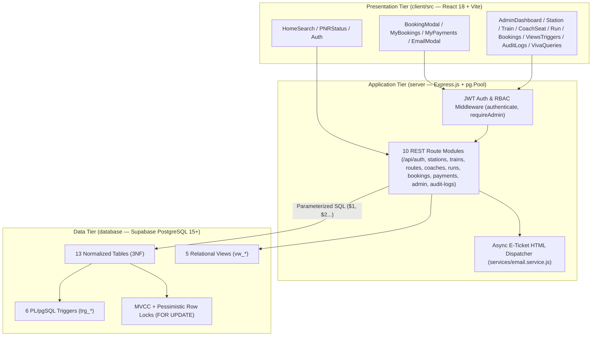

# IR-RailOps — Railway Management System: Comprehensive DBMS Project Summary

> Full-stack relational database application built on **PostgreSQL 15+ (Supabase)**, **Node.js / Express.js (`pg`)**, and **React 18 (Vite)**, modeling IRCTC-style train scheduling, seat inventory management, ACID ticket reservations, waitlist promotion, relational views, and PL/pgSQL audit/integrity triggers.

---

## 1. Detailed DBMS Project Summary

### 1.1 Architectural Overview
The system follows a strict **3-tier client–server–database architecture** where the relational database engine enforces structural, referential, and transactional integrity:



### 1.2 Technology Stack & Project Layout

| Layer | Technology / Files | Responsibility |
|---|---|---|
| **Database** | PostgreSQL 15+ (`database/schema.sql`, `database/views_and_triggers.sql`, `database/seed.sql`, `database/demo_queries.sql`) | 13 tables, indexes, 5 views, 6 PL/pgSQL triggers, ACID transactions, row-level locks |
| **Backend** | Node.js, Express 4, `pg`, `bcryptjs`, `jsonwebtoken`, `nodemailer` (`server/server.js`, `server/db.js`, `server/routes/*.js`, `server/middleware/auth.js`, `server/scripts/*.js`) | REST API, parameterized query execution, transaction orchestration, JWT RBAC, DB initialization & migration scripts |
| **Frontend** | React 18, Vite 5, React Router 6, Lucide React, CSS3 (`client/src/App.jsx`, `client/src/pages/**`, `client/src/components/**`, `client/src/context/**`) | Passenger booking/PNR/payment portal and 9-module Admin Control Panel |

### 1.3 Core DBMS Concepts Implemented

1. **Physical vs. Operational Separation**:
   - `Train` stores static rolling stock metadata; `Train_Run` stores daily service instances on specific calendar dates (`UNIQUE (Train_ID, Service_Date)`).
   - `Seat` stores physical coach hardware and maintenance state (`OPERATIONAL` vs `UNDER_REPAIR`); `Seat_Allocation` tracks per-run inventory (`AVAILABLE`, `BOOKED`, `BLOCKED`).
2. **Directional Graph / Timetable Matching**:
   - `Route_Schedule` enforces ordered stops (`UNIQUE (Train_ID, Stop_Sequence)` and `UNIQUE (Train_ID, Station_ID)`). Searching between Origin and Destination performs a **self-join** validating `rs1.stop_sequence < rs2.stop_sequence`.
3. **ACID Transactions & Pessimistic Concurrency Control**:
   - `POST /api/bookings` opens a dedicated `pg` client transaction (`BEGIN ... COMMIT / ROLLBACK`), locks available operational seats with `SELECT ... FOR UPDATE LIMIT N`, creates `Ticket_Header`, `Passenger`, and `Ticket_Detail` records, updates `Seat_Allocation`, and records `Payment`.
   - Includes a **Simulate Payment Failure** toggle that inserts `FAILED` payment and immediately triggers `ROLLBACK`, releasing locks with zero partial persistence.
4. **Automated FIFO Waitlist Promotion**:
   - `POST /api/bookings/cancel` locks active tickets (`FOR UPDATE`), cancels the passenger's `Ticket_Detail`, locates the earliest waitlisted passenger (`ORDER BY detail_id ASC LIMIT 1 FOR UPDATE`) on the same `Run_ID`, promotes them to `CONFIRMED` with the freed `Allocation_ID`, or returns the seat to `AVAILABLE`.
5. **Database Views (`5 Views`)**:
   - `vw_booking_details`, `vw_train_occupancy`, `vw_revenue_summary`, `vw_route_timetable`, and `vw_audit_trail` encapsulate multi-table joins and aggregations.
6. **PL/pgSQL Triggers (`6 Triggers`)**:
   - Automated audit logging (`trg_seat_allocation_audit`, `trg_payment_audit`, `trg_train_run_status_audit`), physical-to-allocation maintenance synchronization (`trg_sync_seat_condition`), and database-enforced integrity guards (`trg_prevent_repair_seat_booking`, `trg_validate_train_stations`).
7. **SQL Injection & Access Protection**:
   - Every query uses `pg` positional parameters (`$1, $2, ...`), passwords use `bcryptjs` (salt rounds 10), and admin endpoints enforce JWT verification + `ADMIN` role checks.

---

## 2. Database Normalization: Before 1NF → 1NF → 2NF → 3NF (and After 3NF)

Below is the complete normalization progression showing how the domain is decomposed from unnormalized multi-valued structures into all **13 Third Normal Form (3NF) tables**.

### 2.1 Before 1NF — Unnormalized Form (UNF)
Before applying 1NF, railway data stored in a flat operational sheet contains **repeating groups, comma-separated multi-valued attributes, and mixed entity concerns**:

1. **`UNF_Train_Schedule_Sheet`**  
   `{ Train_ID, Train_Name, Train_Type, Source_Code, Source_Name, Source_City, Source_State, Dest_Code, Dest_Name, Dest_City, Dest_State, Stops_CSV (Station_Code + Arrival + Departure), Coaches_And_Seats_CSV (Coach_Type + Seat_Numbers + Conditions) }`
   - *Violation*: Repeating groups in `Stops_CSV` and `Coaches_And_Seats_CSV`.

2. **`UNF_Reservation_Ledger`**  
   `{ PNR, Booking_Date, User_Email, Password_Hash, Role, Train_ID, Train_Name, Service_Date, Run_Status, From_Station_Code, From_Station_Name, To_Station_Code, To_Station_Name, Passenger_Names_CSV, Passenger_Ages_CSV, Passenger_Genders_CSV, Seat_Numbers_CSV, Coach_Types_CSV, Ticket_Statuses_CSV, Payment_Amounts_CSV, Payment_Statuses_CSV, Total_Amount, Audit_Events_CSV }`
   - *Violations*: Multi-valued passenger lists, seat allocations, payment retries, and audit logs packed into single rows; massive insertion, update, and deletion anomalies.

---

### 2.2 First Normal Form (1NF) — Atomic Attributes & Primary Keys
To achieve **1NF**, all repeating groups and CSV lists are flattened so every column holds a single atomic value and every relation has a defined primary key. However, **partial dependencies** (attributes depending on only part of a composite PK) and **transitive dependencies** still remain.

| # | 1NF Relation | Primary Key | Attributes | Remaining Anomalies (Violates 2NF/3NF) |
|---|---|---|---|---|
| 1 | `1NF_Train_Stop` | `(Train_ID, Stop_Sequence)` | `Train_ID, Stop_Sequence, Train_Name, Train_Type, Source_ID, Source_Code, Source_Name, Source_City, Source_State, Destination_ID, Dest_Code, Dest_Name, Station_ID, Station_Code, Station_Name, City, State, Arrival_Time, Departure_Time` | Partial dependency: `Train_Name, Train_Type, Source_*, Dest_*` depend only on `Train_ID`. Transitive: `Station_*` depends on `Station_ID`. |
| 2 | `1NF_Run_Seat_Inventory` | `(Run_ID, Seat_ID)` | `Run_ID, Seat_ID, Train_ID, Service_Date, Run_Status, Coach_ID, Coach_Type, Coach_Capacity, Seat_Number, Physical_Condition, Booking_Status` | Partial dependency: `Train_ID, Service_Date, Run_Status` depend only on `Run_ID`; `Coach_ID, Seat_Number, Physical_Condition` depend only on `Seat_ID`. Derived column: `Coach_Capacity`. |
| 3 | `1NF_Ticket_LineItem` | `(PNR, Detail_ID)` | `PNR, Detail_ID, User_ID, Email, Password_Hash, Role, User_Created_At, Run_ID, From_Station_ID, From_Code, From_Name, To_Station_ID, To_Code, To_Name, Booking_Date, Total_Amount, Passenger_ID, Passenger_Name, Age, Gender, Allocation_ID, Current_Status` | Partial dependency: `User_*, Run_ID, From_*, To_*, Booking_Date, Total_Amount` depend only on `PNR`. Transitive: `Email, Role` depend on `User_ID`; `Passenger_Name, Age, Gender` depend on `Passenger_ID`. |
| 4 | `1NF_Payment_Record` | `Transaction_ID` | `Transaction_ID, PNR, Amount, Payment_Status, Timestamp` | Already 2NF/3NF once `PNR` references `Ticket_Header`. |
| 5 | `1NF_Audit_Record` | `Log_ID` | `Log_ID, Action_Type, Table_Affected, Created_At, User_ID, User_Email, User_Role` | Transitive dependency: `User_Email, User_Role` depend on `User_ID`. |

---

### 2.3 Second Normal Form (2NF) — Eliminate Partial Dependencies
To achieve **2NF**, every non-prime attribute must be **fully functionally dependent on the entire primary key**. Composite-key tables from 1NF are split so train metadata, run metadata, coach/seat hardware, and ticket headers move into their own relations.

| # | 2NF Relation | Primary Key | Attributes | Remaining Transitive Dependencies (Violates 3NF) |
|---|---|---|---|---|
| 1 | `2NF_Train` | `Train_ID` | `Train_ID, Name, Type, Source_ID, Source_Code, Source_Name, Destination_ID, Dest_Code, Dest_Name` | `Source_ID -> Source_Code, Source_Name`; `Destination_ID -> Dest_Code, Dest_Name`. |
| 2 | `2NF_Route_Schedule` | `Schedule_ID` *(CK: `(Train_ID, Stop_Sequence)`)* | `Schedule_ID, Train_ID, Station_ID, Station_Code, Station_Name, City, State, Stop_Sequence, Arrival_Time, Departure_Time` | `Station_ID -> Station_Code, Station_Name, City, State`. |
| 3 | `2NF_Coach_Seat` | `Seat_ID` | `Seat_ID, Coach_ID, Train_ID, Coach_Type, Coach_Capacity, Seat_Number, Physical_Condition` | `Coach_ID -> Train_ID, Coach_Type, Coach_Capacity` (plus `Coach_Capacity` is derived). |
| 4 | `2NF_Train_Run` | `Run_ID` | `Run_ID, Train_ID, Service_Date, Run_Status` | None (already in 3NF). |
| 5 | `2NF_Seat_Allocation` | `Allocation_ID` *(CK: `(Run_ID, Seat_ID)`)* | `Allocation_ID, Run_ID, Seat_ID, Booking_Status` | None (already in 3NF). |
| 6 | `2NF_Ticket_Header` | `PNR` | `PNR, User_ID, Email, Password_Hash, Role, Run_ID, From_Station_ID, From_Name, To_Station_ID, To_Name, Booking_Date, Total_Amount` | `User_ID -> Email, Password_Hash, Role`; `From_Station_ID -> From_Name`; `To_Station_ID -> To_Name`. |
| 7 | `2NF_Ticket_Detail` | `Detail_ID` | `Detail_ID, PNR, Passenger_ID, User_ID, Passenger_Name, Age, Gender, Allocation_ID, Current_Status` | `Passenger_ID -> User_ID, Passenger_Name, Age, Gender`. |
| 8 | `2NF_Payment` | `Transaction_ID` | `Transaction_ID, PNR, Amount, Payment_Status, Timestamp` | None (already in 3NF). |
| 9 | `2NF_Audit_Log` | `Log_ID` | `Log_ID, Action_Type, Table_Affected, Created_At, User_ID, User_Email, User_Role` | `User_ID -> User_Email, User_Role`. |

---

### 2.4 Third Normal Form (3NF) & After 3NF — Final 13 Normalized Tables
To achieve **3NF**, all **transitive dependencies** ($X \to Y \to Z$) and derived columns (`Coach_Capacity`) are removed into dedicated master entities (`Station`, `Coach`, `User_Account`, `Passenger`).

Below are **all 13 normalized tables after 3NF** as implemented in [`database/schema.sql`](file:///c:/development/railway/database/schema.sql):

#### Tier 1: Static Railway Infrastructure (5 Tables)

| # | Table Name | Columns & Constraints (After 3NF) | Why 3NF / BCNF Holds |
|---|---|---|---|
| **1** | **`Station`** | `Station_ID` (PK, Identity), `Station_Code` (VARCHAR(10), UNIQUE, NOT NULL), `Name` (VARCHAR(100), NOT NULL), `City` (VARCHAR(50), NOT NULL), `State` (VARCHAR(50), NOT NULL). Indexes: `idx_station_code`, `idx_station_city`. | Candidate keys `Station_ID` and `Station_Code` determine all attributes directly; no transitive dependency (`City`/`State` are stored per station entity). |
| **2** | **`Train`** | `Train_ID` (PK, Identity), `Name` (VARCHAR(100), NOT NULL), `Type` (VARCHAR(30), NOT NULL), `Source_ID` (FK → `Station`, `ON DELETE RESTRICT`), `Destination_ID` (FK → `Station`, `ON DELETE RESTRICT`). Index: `idx_train_type`. Trigger: `trg_validate_train_stations`. | Stores only `Source_ID` and `Destination_ID` FKs instead of station names/cities. |
| **3** | **`Route_Schedule`** | `Schedule_ID` (PK, Identity), `Train_ID` (FK → `Train`, `ON DELETE CASCADE`), `Station_ID` (FK → `Station`, `ON DELETE RESTRICT`), `Stop_Sequence` (INT, NOT NULL), `Arrival_Time` (TIME NULL), `Departure_Time` (TIME NULL). `UNIQUE (Train_ID, Stop_Sequence)`, `UNIQUE (Train_ID, Station_ID)`. Index: `idx_schedule_train_seq`. | Both candidate keys (`Schedule_ID`, `(Train_ID, Stop_Sequence)`) are superkeys; station details stay in `Station`. |
| **4** | **`Coach`** | `Coach_ID` (PK, Identity), `Train_ID` (FK → `Train`, `ON DELETE CASCADE`), `Coach_Type` (VARCHAR(20), NOT NULL). Index: `idx_coach_train`. | Derived `Coach_Capacity` is removed and calculated dynamically via `COUNT(Seat_ID)`. |
| **5** | **`Seat`** | `Seat_ID` (PK, Identity), `Coach_ID` (FK → `Coach`, `ON DELETE CASCADE`), `Seat_Number` (VARCHAR(10), NOT NULL), `Physical_Condition` (VARCHAR(30), DEFAULT `'OPERATIONAL'`, `CHECK IN ('OPERATIONAL', 'UNDER_REPAIR')`). `UNIQUE (Coach_ID, Seat_Number)`. Index: `idx_seat_condition`. | Physical seat hardware & repair state is isolated from per-run booking availability. |

#### Tier 2: Runtime Service & Seat Inventory (2 Tables)

| # | Table Name | Columns & Constraints (After 3NF) | Why 3NF / BCNF Holds |
|---|---|---|---|
| **6** | **`Train_Run`** | `Run_ID` (PK, Identity), `Train_ID` (FK → `Train`, `ON DELETE CASCADE`), `Service_Date` (DATE, NOT NULL), `Run_Status` (VARCHAR(20), DEFAULT `'SCHEDULED'`, `CHECK IN ('SCHEDULED', 'RUNNING', 'DELAYED', 'CANCELLED', 'COMPLETED')`). `UNIQUE (Train_ID, Service_Date)`. Indexes: `idx_run_date`, `idx_run_status`. | Separates recurring date-specific runs from static `Train` definitions. |
| **7** | **`Seat_Allocation`** | `Allocation_ID` (PK, Identity), `Run_ID` (FK → `Train_Run`, `ON DELETE CASCADE`), `Seat_ID` (FK → `Seat`, `ON DELETE CASCADE`), `Booking_Status` (VARCHAR(20), DEFAULT `'AVAILABLE'`, `CHECK IN ('AVAILABLE', 'BLOCKED', 'BOOKED')`). `UNIQUE (Run_ID, Seat_ID)`. Index: `idx_alloc_status`. | Resolves the M:N relationship between `Train_Run` and `Seat` with atomic `Booking_Status`. |

#### Tier 3: Users, Reservations, Payments & Auditing (6 Tables)

| # | Table Name | Columns & Constraints (After 3NF) | Why 3NF / BCNF Holds |
|---|---|---|---|
| **8** | **`User_Account`** | `User_ID` (PK, Identity), `Email` (VARCHAR(100), UNIQUE, NOT NULL), `Password_Hash` (VARCHAR(255), NOT NULL), `Role` (VARCHAR(20), DEFAULT `'PASSENGER'`, `CHECK IN ('PASSENGER', 'ADMIN')`), `Created_At` (TIMESTAMPTZ). Index: `idx_user_role`. | Isolates authentication credentials and RBAC role from bookings and audit logs. |
| **9** | **`Passenger`** | `Passenger_ID` (PK, Identity), `User_ID` (FK → `User_Account`, `ON DELETE CASCADE`), `Name` (VARCHAR(100), NOT NULL), `Age` (INT, `CHECK (Age > 0)`), `Gender` (VARCHAR(10), NOT NULL). Index: `idx_passenger_user`. | Eliminates repeating traveler profiles and transitive dependencies from `Ticket_Detail`. |
| **10** | **`Ticket_Header`** | `PNR` (VARCHAR(10), PK), `User_ID` (FK → `User_Account`, `ON DELETE RESTRICT`), `Run_ID` (FK → `Train_Run`, `ON DELETE RESTRICT`), `From_Station_ID` (FK → `Station`, `ON DELETE RESTRICT`), `To_Station_ID` (FK → `Station`, `ON DELETE RESTRICT`), `Booking_Date` (TIMESTAMPTZ), `Total_Amount` (NUMERIC(10,2), NOT NULL). Indexes: `idx_ticket_user`, `idx_ticket_run`, `idx_ticket_booking_date`. | Stores only FKs for user, run, and stations—no redundant station or user attributes. |
| **11** | **`Ticket_Detail`** | `Detail_ID` (PK, Identity), `PNR` (FK → `Ticket_Header`, `ON DELETE CASCADE`), `Passenger_ID` (FK → `Passenger`, `ON DELETE RESTRICT`), `Allocation_ID` (FK → `Seat_Allocation`, `ON DELETE SET NULL`, NULLABLE for waitlist), `Current_Status` (VARCHAR(20), `CHECK IN ('CONFIRMED', 'WAITLIST', 'CANCELLED')`). Indexes: `idx_detail_status`, `idx_detail_pnr`. | Atomic per-passenger reservation line item; `Allocation_ID` is nullable for waitlisted tickets. |
| **12** | **`Payment`** | `Transaction_ID` (PK, Identity), `PNR` (FK → `Ticket_Header`, `ON DELETE CASCADE`), `Amount` (NUMERIC(10,2), NOT NULL), `Payment_Status` (VARCHAR(20), `CHECK IN ('SUCCESS', 'FAILED', 'REFUNDED')`), `Timestamp` (TIMESTAMPTZ). Indexes: `idx_payment_pnr`, `idx_payment_status`. | Supports multiple settlement/retry/refund attempts per `PNR` cleanly. |
| **13** | **`Audit_Log`** | `Log_ID` (PK, Identity), `Action_Type` (VARCHAR(50), NOT NULL), `Table_Affected` (VARCHAR(50), NOT NULL), `Created_At` (TIMESTAMPTZ), `User_ID` (FK → `User_Account`, `ON DELETE SET NULL`, NULLABLE for system triggers). Indexes: `idx_audit_time`, `idx_audit_action`. | Stores only `User_ID` FK (no `User_Email` or `User_Role`); enriched via `vw_audit_trail`. |

---

## 3. Main Queries & Where They Are Used

### 3.1 Passenger Search, Booking, Cancellation & Lookup Queries

| # | Query / Transaction | DBMS Concept | Backend File & Endpoint | Frontend Page / Component |
|---|---|---|---|---|
| **Q1** | **Directional Train Search & Availability** | Self-join on `Route_Schedule` (`rs1.stop_sequence < rs2.stop_sequence`), conditional aggregation (`SUM(CASE WHEN ...)`), auto-provisioning `Train_Run` + `Seat_Allocation` | `GET /api/trains/search` in [`server/routes/train.routes.js`](file:///c:/development/railway/server/routes/train.routes.js#L8-L134) | [`HomeSearch.jsx`](file:///c:/development/railway/client/src/pages/HomeSearch.jsx) |
| **Q2** | **ACID Booking + Pessimistic Seat Locking** | `BEGIN` / `COMMIT` / `ROLLBACK`, `SELECT ... FOR UPDATE LIMIT $2` on operational `Seat_Allocation`, multi-table inserts (`Ticket_Header`, `Passenger`, `Ticket_Detail`, `Payment`, `Audit_Log`) | `POST /api/bookings` in [`server/routes/booking.routes.js`](file:///c:/development/railway/server/routes/booking.routes.js#L32-L230) | [`BookingModal.jsx`](file:///c:/development/railway/client/src/components/BookingModal.jsx) |
| **Q3** | **PNR Status & E-Ticket Lookup via View** | Relational View query (`SELECT ... FROM vw_booking_details WHERE "pnr" = $1`) encapsulating 10-table join + latest payment subquery | `GET /api/bookings/pnr/:pnr` & `GET /api/bookings/email/:pnr` in [`server/routes/booking.routes.js`](file:///c:/development/railway/server/routes/booking.routes.js#L234-L372) | [`PNRStatus.jsx`](file:///c:/development/railway/client/src/pages/PNRStatus.jsx), [`EmailModal.jsx`](file:///c:/development/railway/client/src/components/EmailModal.jsx), [`ViewsTriggersManager.jsx`](file:///c:/development/railway/client/src/pages/admin/ViewsTriggersManager.jsx) |
| **Q4** | **Ticket Cancellation & FIFO Waitlist Promotion** | Transaction with `FOR UPDATE` on `Ticket_Detail`, earliest waitlisted lookup (`ORDER BY detail_id ASC LIMIT 1 FOR UPDATE`), seat transfer or release + `REFUNDED` payment | `POST /api/bookings/cancel` in [`server/routes/booking.routes.js`](file:///c:/development/railway/server/routes/booking.routes.js#L481-L616) | [`PNRStatus.jsx`](file:///c:/development/railway/client/src/pages/PNRStatus.jsx) |
| **Q5** | **My Bookings Summary** | Multi-table join + `GROUP BY` passenger status counts + latest `Payment` correlated subquery | `GET /api/bookings/my` in [`server/routes/booking.routes.js`](file:///c:/development/railway/server/routes/booking.routes.js#L375-L417) | [`MyBookings.jsx`](file:///c:/development/railway/client/src/pages/MyBookings.jsx) |
| **Q6** | **Payment History & Retry Settlement** | Filtered join across `Payment`, `Ticket_Header`, `User_Account`, `Train_Run`, `Train`; `INSERT INTO payment` firing `trg_payment_audit` | `GET /api/payments` & `POST /api/payments/retry` in [`server/routes/payment.routes.js`](file:///c:/development/railway/server/routes/payment.routes.js#L7-L80) | [`MyPayments.jsx`](file:///c:/development/railway/client/src/pages/MyPayments.jsx) |
| **Q7** | **User Registration & Login** | Transactional user + passenger insert (`BEGIN ... COMMIT`), case-insensitive lookup `LOWER("email") = LOWER($1)` | `POST /api/auth/register` & `POST /api/auth/login` in [`server/routes/auth.routes.js`](file:///c:/development/railway/server/routes/auth.routes.js#L10-L150) | [`Register.jsx`](file:///c:/development/railway/client/src/pages/Register.jsx), [`Login.jsx`](file:///c:/development/railway/client/src/pages/Login.jsx) |

#### Key SQL Excerpts (Core Passenger Workflows)

**Q1 — Directional Route Search (`train.routes.js`)**:
```sql
SELECT t.train_id AS "Train_ID", t.name AS "Train_Name", t.type AS "Train_Type",
       rs1.departure_time AS "Departure_Time", rs2.arrival_time AS "Arrival_Time",
       tr.run_id AS "Run_ID", COALESCE(seat_stats.available_seats, 0)::int AS "Available_Seats"
FROM "train" t
JOIN "route_schedule" rs1 ON t.train_id = rs1.train_id AND rs1.station_id = $1
JOIN "route_schedule" rs2 ON t.train_id = rs2.train_id AND rs2.station_id = $2
JOIN "station" st1 ON rs1.station_id = st1.station_id
JOIN "station" st2 ON rs2.station_id = st2.station_id
JOIN "train_run" tr ON t.train_id = tr.train_id AND tr.service_date = $3
LEFT JOIN (
    SELECT sa.run_id,
           COUNT(sa.allocation_id) AS total_operational_seats,
           SUM(CASE WHEN sa.booking_status = 'AVAILABLE' THEN 1 ELSE 0 END) AS available_seats,
           SUM(CASE WHEN sa.booking_status = 'BOOKED' THEN 1 ELSE 0 END) AS booked_seats
    FROM "seat_allocation" sa
    JOIN "seat" s ON sa.seat_id = s.seat_id AND s.physical_condition = 'OPERATIONAL'
    GROUP BY sa.run_id
) seat_stats ON tr.run_id = seat_stats.run_id
WHERE rs1.stop_sequence < rs2.stop_sequence
ORDER BY rs1.departure_time ASC;
```

**Q2 — Pessimistic Seat Lock (`booking.routes.js`)**:
```sql
SELECT sa."allocation_id", sa."seat_id", s."seat_number", c."coach_type", c."coach_id"
FROM "seat_allocation" sa
JOIN "seat" s ON sa."seat_id" = s."seat_id"
JOIN "coach" c ON s."coach_id" = c."coach_id"
WHERE sa."run_id" = $1 AND sa."booking_status" = 'AVAILABLE' AND s."physical_condition" = 'OPERATIONAL'
ORDER BY sa."allocation_id" ASC
LIMIT $2
FOR UPDATE;
```

**Q4 — Earliest Waitlisted Candidate Promotion (`booking.routes.js`)**:
```sql
SELECT td."detail_id", td."pnr", td."passenger_id", p."name" AS "passenger_name"
FROM "ticket_detail" td
JOIN "ticket_header" th ON td."pnr" = th."pnr"
JOIN "passenger" p ON td."passenger_id" = p."passenger_id"
WHERE th."run_id" = $1 AND td."current_status" = 'WAITLIST'
ORDER BY td."detail_id" ASC
LIMIT 1
FOR UPDATE;
```

---

### 3.2 Admin Operations, Fleet, Views & Trigger Queries

| # | Query / Operation | DBMS Concept | Backend File & Endpoint | Frontend Page |
|---|---|---|---|---|
| **Q8** | **Dashboard KPIs & Recent Bookings** | Scalar aggregates (`COUNT`, `SUM`, `ROUND`, `NULLIF`), `IN` subquery for latest payment per PNR | `GET /api/admin/dashboard` in [`server/routes/admin.routes.js`](file:///c:/development/railway/server/routes/admin.routes.js#L7-L97) | [`AdminDashboard.jsx`](file:///c:/development/railway/client/src/pages/admin/AdminDashboard.jsx) |
| **Q9** | **Occupancy, Revenue & Timetable Reports (Views)** | Querying `vw_train_occupancy`, `vw_revenue_summary`, `vw_route_timetable` | `GET /api/admin/reports/occupancy`, `/revenue`, `/timetable` in [`server/routes/admin.routes.js`](file:///c:/development/railway/server/routes/admin.routes.js#L100-L152) | [`ViewsTriggersManager.jsx`](file:///c:/development/railway/client/src/pages/admin/ViewsTriggersManager.jsx) |
| **Q10** | **Live Catalog Inspection (Views & Triggers)** | PostgreSQL system catalogs (`pg_views`, `pg_class`, `pg_trigger`, `pg_proc`, `pg_get_viewdef`, `pg_get_triggerdef`) + trigger-only `Audit_Log` query | `GET /api/admin/db-objects` in [`server/routes/admin.routes.js`](file:///c:/development/railway/server/routes/admin.routes.js#L156-L199) | [`ViewsTriggersManager.jsx`](file:///c:/development/railway/client/src/pages/admin/ViewsTriggersManager.jsx) |
| **Q11** | **System Bookings Ledger** | Dynamic parameterized `ILIKE` / date filters + multi-table `GROUP BY` | `GET /api/bookings/all` in [`server/routes/booking.routes.js`](file:///c:/development/railway/server/routes/booking.routes.js#L420-L477) | [`BookingsManager.jsx`](file:///c:/development/railway/client/src/pages/admin/BookingsManager.jsx) |
| **Q12** | **Station CRUD & Referential Guards** | Pre-delete FK checks on `Train` and `Route_Schedule`, `COALESCE` partial update | `/api/stations` in [`server/routes/station.routes.js`](file:///c:/development/railway/server/routes/station.routes.js#L8-L163) | [`StationManager.jsx`](file:///c:/development/railway/client/src/pages/admin/StationManager.jsx) |
| **Q13** | **Train Fleet & Route Timetable CRUD** | Transactional train creation with default `Route_Schedule` endpoints; cascade/booking delete guard | `/api/trains` in [`server/routes/train.routes.js`](file:///c:/development/railway/server/routes/train.routes.js#L138-L352), `/api/routes` in [`server/routes/route.routes.js`](file:///c:/development/railway/server/routes/route.routes.js#L7-L139) | [`TrainManager.jsx`](file:///c:/development/railway/client/src/pages/admin/TrainManager.jsx) |
| **Q14** | **Coach Capacity & Seat Repair Sync** | Derived capacity (`COUNT`), transactional `Seat.Physical_Condition` update + `Seat_Allocation` sync (`trg_sync_seat_condition`) | `/api/coaches` in [`server/routes/coach.routes.js`](file:///c:/development/railway/server/routes/coach.routes.js#L7-L148) | [`CoachSeatManager.jsx`](file:///c:/development/railway/client/src/pages/admin/CoachSeatManager.jsx) |
| **Q15** | **Train Run Scheduling & Status Updates** | Batch `Seat_Allocation` initialization per train seat (`BLOCKED` if `UNDER_REPAIR`), status update firing `trg_train_run_status_audit` | `/api/runs` in [`server/routes/run.routes.js`](file:///c:/development/railway/server/routes/run.routes.js#L7-L194) | [`RunManager.jsx`](file:///c:/development/railway/client/src/pages/admin/RunManager.jsx) |
| **Q16** | **Audit Trail Filtering** | `LEFT JOIN` on `User_Account`, dynamic `ILIKE` + `source=triggers|users` (`user_id IS NULL`) | `GET /api/audit-logs` in [`server/routes/audit.routes.js`](file:///c:/development/railway/server/routes/audit.routes.js#L7-L56) | [`AuditLogs.jsx`](file:///c:/development/railway/client/src/pages/admin/AuditLogs.jsx) |

---

### 3.3 Database Views & Triggers Reference

| Object Name | Type | Target / Base Tables | Where Consumed / Fired |
|---|---|---|---|
| `vw_booking_details` | View | `Ticket_Header`, `User_Account`, `Train_Run`, `Train`, `Station` (x2), `Ticket_Detail`, `Passenger`, `Seat_Allocation`, `Seat`, `Coach`, `Payment` | `GET /api/bookings/pnr/:pnr`, `GET /api/bookings/email/:pnr`, `ViewsTriggersManager.jsx`, `VivaQueries.jsx` |
| `vw_train_occupancy` | View | `Train_Run`, `Train`, `Seat_Allocation` | `GET /api/admin/reports/occupancy`, `ViewsTriggersManager.jsx` |
| `vw_revenue_summary` | View | `Train`, `Train_Run`, `Ticket_Header`, `Payment` | `GET /api/admin/reports/revenue`, `ViewsTriggersManager.jsx` |
| `vw_route_timetable` | View | `Train`, `Route_Schedule`, `Station` | `GET /api/admin/reports/timetable`, `ViewsTriggersManager.jsx` |
| `vw_audit_trail` | View | `Audit_Log`, `User_Account` | `VivaQueries.jsx` / SQL reporting |
| `trg_seat_allocation_audit` | Trigger (`AFTER UPDATE`) | `Seat_Allocation` | Fires on booking (`POST /api/bookings`), cancellation (`POST /api/bookings/cancel`), and repair sync |
| `trg_payment_audit` | Trigger (`AFTER INSERT`) | `Payment` | Fires on booking payment (`POST /api/bookings`), cancellation refund (`POST /api/bookings/cancel`), and retry (`POST /api/payments/retry`) |
| `trg_sync_seat_condition` | Trigger (`AFTER UPDATE`) | `Seat` (`Physical_Condition`) | Fires on seat maintenance toggle (`PUT /api/coaches/seats/:seatId/condition`) or direct SQL `UPDATE Seat` |
| `trg_prevent_repair_seat_booking` | Trigger (`BEFORE INSERT/UPDATE`) | `Seat_Allocation` (`Booking_Status`) | Guards every booking/allocation write against assigning an `UNDER_REPAIR` seat |
| `trg_train_run_status_audit` | Trigger (`AFTER UPDATE`) | `Train_Run` (`Run_Status`) | Fires on delay/status changes (`PUT /api/runs/:runId/status`) |
| `trg_validate_train_stations` | Trigger (`BEFORE INSERT/UPDATE`) | `Train` (`Source_ID`, `Destination_ID`) | Guards `POST /api/trains` and direct SQL writes against `Source_ID = Destination_ID` |

