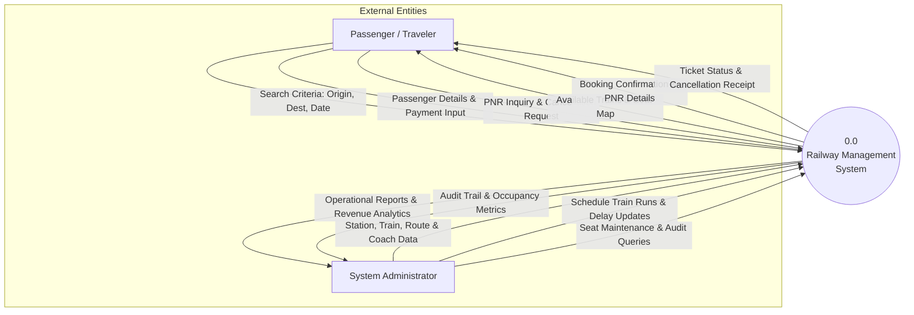

# Data Flow Diagrams (DFD)

This document specifies the Data Flow Diagrams (Context Level 0, Level 1, and Detailed Sub-processes) for the **Railway Management System**.

---

## 1. Context Diagram (Level 0 DFD)

---

## 2. Level 1 DFD (Decomposed System Architecture)

```mermaid
flowchart TD
    %% Entities
    Passenger[Passenger]
    Admin[Administrator]

    %% Processes
    P1((1.0<br/>Authentication &<br/>Profile Management))
    P2((2.0<br/>Train & Route<br/>Management))
    P3((3.0<br/>Train Run & Seat<br/>Allocation Initialization))
    P4((4.0<br/>Search & Seat<br/>Availability))
    P5((5.0<br/>Transactional Booking<br/>& Payment Settlement))
    P6((6.0<br/>PNR Status &<br/>History Lookup))
    P7((7.0<br/>Cancellation &<br/>Waitlist Promotion))
    P8((8.0<br/>Admin Analytics<br/>& Audit Logging))

    %% Data Stores (Tables)
    D1[(D1: User_Account & Passenger)]
    D2[(D2: Station, Train, Route_Schedule)]
    D3[(D3: Coach & Seat)]
    D4[(D4: Train_Run & Seat_Allocation)]
    D5[(D5: Ticket_Header & Ticket_Detail)]
    D6[(D6: Payment)]
    D7[(D7: Audit_Log)]

    %% Data Flows
    Passenger -->|Credentials / Profile| P1
    Admin -->|Admin Credentials| P1
    P1 <-->|Read / Write Users| D1

    Admin -->|Station / Train / Route Definitions| P2
    P2 <-->|CRUD Stations, Trains, Schedules| D2

    Admin -->|Coach & Seat Configuration| P2
    P2 <-->|CRUD Rolling Stock| D3

    Admin -->|Create Train Run on Date| P3
    P3 -->|Query Active Coaches & Seats| D3
    P3 -->|Initialize Runs & Allocations| D4

    Passenger -->|Origin, Destination, Date| P4
    P4 -->|Match Route Sequence & Stops| D2
    P4 -->|Verify Active Run| D4
    P4 -->|Count Available Operational Seats| D4
    P4 -->|Return Matching Trains| Passenger

    Passenger -->|Passenger List, Run Selection| P5
    P5 -->|Lock Available Seats SELECT FOR UPDATE| D4
    P5 -->|Update Seat_Allocation to BOOKED| D4
    P5 -->|Insert Reservation Header & Details| D5
    P5 -->|Record Payment Transaction| D6
    P5 -->|Generate Audit Log| D7
    P5 -->|Return PNR & Confirmed Details| Passenger

    Passenger -->|Input PNR / View My Tickets| P6
    P6 -->|Fetch Reservation Records| D5
    P6 -->|Fetch Route & Stop Details| D2
    P6 -->|Return Ticket Breakdown| Passenger

    Passenger -->|Cancel Ticket by PNR / Detail_ID| P7
    P7 -->|Update Detail to CANCELLED| D5
    P7 -->|Release Seat_Allocation to AVAILABLE| D4
    P7 -->|Check for Oldest WAITLISTED Passenger| D5
    P7 -->|Promote Waitlisted to CONFIRMED with Seat| D5
    P7 -->|Log Cancellation & Promotion| D7
    P7 -->|Return Refund / Promotion Notice| Passenger

    Admin -->|Query Performance Metrics| P8
    P8 -->|Aggregate Revenue & Payments| D6
    P8 -->|Aggregate Occupancy & Train Runs| D4
    P8 -->|Fetch Audit Trail| D7
    P8 -->|Render Analytics Dashboard| Admin
```

---

## 3. Detailed Data Store Reference

| Data Store ID | Corresponding SQL Table(s) | Role & Process Interaction |
|---|---|---|
| **D1** | `User_Account`, `Passenger` | Stores credentials, hashed passwords, roles (`ADMIN`, `PASSENGER`), and passenger identities. |
| **D2** | `Station`, `Train`, `Route_Schedule` | Static railway infrastructure, route topological ordering, and station master records. |
| **D3** | `Coach`, `Seat` | Physical rolling stock hierarchy and physical maintenance conditions (`OPERATIONAL` / `UNDER_REPAIR`). |
| **D4** | `Train_Run`, `Seat_Allocation` | Operational runtime calendar, service date tracking, and per-date seat inventory. |
| **D5** | `Ticket_Header`, `Ticket_Detail` | Master reservation header with 10-char PNR and individual passenger ticket statuses (`CONFIRMED`, `WAITLISTED`, `CANCELLED`). |
| **D6** | `Payment` | Multi-attempt simulated payment transactions and payment audit history. |
| **D7** | `Audit_Log` | Immutable event log populated via application transactions and MySQL database triggers. |
