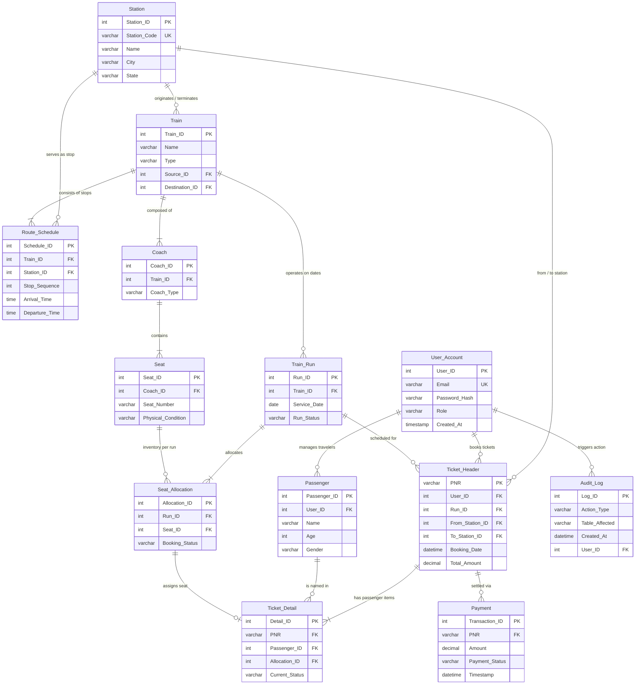

# Entity-Relationship (ER) Diagram

This document contains the Entity-Relationship (ER) model for the **Railway Management System**, modeling all 13 tables, primary keys, foreign keys, and cardinalities.

## Mermaid ER Diagram

## Relational Cardinalities and Business Rules
1. **Station to Train (1:N)**: A station acts as the `Source` or `Destination` for multiple trains.
2. **Train to Route_Schedule (1:N)**: A train follows an ordered sequence of stations identified by `Stop_Sequence`.
3. **Train to Coach (1:N) & Coach to Seat (1:N)**: Physical rolling stock hierarchy. Coach capacity is dynamically derived by counting seats.
4. **Train to Train_Run (1:N)**: A physical train entity is instantiated on specific service dates as a `Train_Run`.
5. **Seat & Train_Run to Seat_Allocation (N:1 & M:N)**: A `Seat_Allocation` maps a physical seat to a train run, isolating per-date booking state (`AVAILABLE`, `BOOKED`, `BLOCKED`).
6. **User_Account to Ticket_Header (1:N)**: A registered passenger creates bookings identified by a unique 10-character `PNR`.
7. **Ticket_Header to Ticket_Detail (1:N)**: Master-detail reservation pattern supporting multi-passenger bookings.
8. **Ticket_Header to Payment (1:N)**: Supports multiple payment attempts (e.g., failure retry) per PNR.
9. **Seat_Allocation to Ticket_Detail (1:0..1)**: Waitlisted tickets have a `NULL` `Allocation_ID` until promoted.
